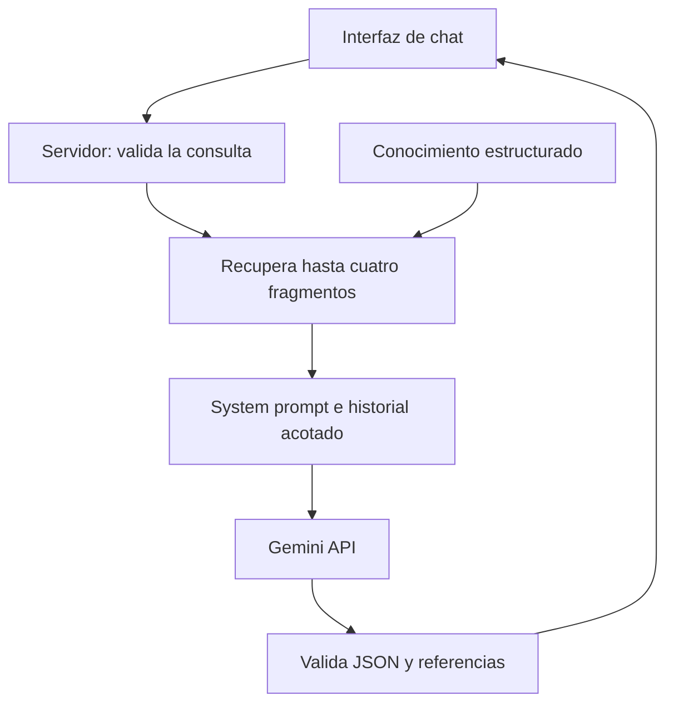

# PicMe — Asistente educativo con Gemini y RAG

**Universidad de Cundinamarca · Seccional Ubaté**  
**CADI:** Introducción a Machine Learning  
**Entrega individual:** Evelin Yijan Virguez Parra

PicMe incorpora un asistente que explica el MEDIT y la Declaración Persona Transhumana mediante conocimiento documentado y una integración con Gemini. El programa de escritorio conserva el reconocimiento facial; la web permite consultar el conocimiento y la reflexión sin acceder a registros biométricos.

**Sitio del proyecto, con acceso inicial privado:** <https://picme-ucundinamarca-medit-yijan.majoremu64.chatgpt.site>

**Pendientes de la entrega evaluable:** configurar y verificar la clave real del LLM, publicar el repositorio público, dar acceso al docente al sitio y grabar el video en inglés. No se presenta una respuesta local ni una prueba simulada como una llamada real a Gemini.

## Inicio en Windows

1. Extrae todo el ZIP.
2. Entra en `desktop` y abre `INSTALAR_WINDOWS.bat` con Python 3.10, 3.11 o 3.12 de 64 bits. La instalación necesita Internet; si falta el modelo facial, lo descarga.
3. Abre `CONFIGURAR_GEMINI.bat`, completa `GEMINI_API_KEY` en el archivo `.env` que se abre y guarda.
4. Ejecuta `VERIFICAR_LLM.bat`: debe confirmar una respuesta real del proveedor.
5. Abre `INICIAR_PICME.bat` o `SOLO_CHATBOT.bat`.

Sin clave, el chat funciona en **modo local**, identificado en la interfaz. Para forzar ese modo aunque exista una clave, usa `PICME_CHAT_MODE=local`.

La fuente publicable crea una base nueva: no contiene datos de usuarios ni plantillas biométricas del archivo original. El conocimiento educativo se reconstruye desde el JSON. El paquete anterior conserva los registros originales si necesitas mantenerlos en tu PC.

## Versión web

La web usa React, TypeScript y Vinext, con un endpoint servidor que llama a Gemini. Se despliega en Cloudflare Workers mediante Sites. La clave se configura como secreto del servidor; no se incluye en el navegador.

Para desarrollo local se necesita Node.js 22.13 o posterior:

```bash
npx pnpm install --frozen-lockfile
npx pnpm dev
```

Crea `.env` a partir de `.env.example` y configura `GEMINI_API_KEY` solo en tu entorno local. En el alojamiento, usa las variables de ejecución del servidor y vuelve a desplegar. El endpoint de estado informa de la configuración, pero una respuesta con `mode: "gemini"` es la que demuestra una generación real.

## Arquitectura



| Archivo o carpeta | Responsabilidad |
| --- | --- |
| `app/page.tsx` | Chat web, declaración, fuentes y reflexión bilingüe. |
| `app/api/chat/route.ts` | Valida solicitudes, controla frecuencia y llama al servicio. |
| `lib/assistant.mjs` | Recuperación léxica, preparación del contexto, Gemini REST y validación de salida. |
| `lib/knowledge.json` | 33 artículos y seis fuentes institucionales. |
| `lib/prompt.mjs` | System prompt con reglas y ejemplos few-shot. |
| `desktop/app/chatbot/rag.py` | Integración RAG y contexto conversacional de escritorio. |
| `desktop/app/chatbot/llm.py` | Cliente Gemini REST para Python. |
| `desktop/app/chatbot/repository.py` | Persistencia SQLite de conocimiento. |
| `desktop/app/gui/views/chatbot_view.py` | Chat de escritorio; consulta al proveedor sin bloquear la ventana. |
| `docs/` | Reflexión, guion, guía de grabación, estado de rúbrica y verificaciones. |

## Base de conocimiento y prompting

La base contiene la introducción institucional y los doce principios aportados en la solicitud, junto con explicaciones, ejemplos y contenidos verificados sobre MEDIT y Ubaté. Las interpretaciones didácticas se distinguen de los textos institucionales.

En escritorio, `data/chatbot.db` tiene las tablas `fuente`, `articulo`, `pregunta_ejemplo` y `metadato`. Para actualizarla, edita `desktop/conocimiento/base_conocimiento.json` y ejecuta `ACTUALIZAR_BD.bat`. El importador valida el contenido y realiza la actualización en una transacción. La web usa la copia equivalente `lib/knowledge.json`; mantén ambos archivos sincronizados cuando cambies el contenido.

El RAG es **léxico**: normaliza texto, usa coincidencias ponderadas y reconoce números de principios. No se usaron embeddings ni se entrenó un LLM desde cero. El prompt delimita el dominio, separa los documentos de las instrucciones, incluye few-shot, pide ejemplos identificados como didácticos y solicita una salida JSON con referencias a los artículos recuperados.

El historial se limita a unos pocos turnos. La aplicación valida que las referencias existan entre los documentos recuperados y construye los enlaces desde su catálogo. Este control no demuestra que cada frase generada esté sustentada: aún hace falta contrastar las fuentes.

## Alcance del agente

Se eligió un asistente educativo en la interfaz, opción permitida por la guía. Puede explicar, relacionar y comparar principios con contexto. No ejecuta SQL ni operaciones CRUD mediante el LLM, y no decide permisos de acceso facial. El backend MySQL original de `desktop/backend` es opcional y no se expone en la web.

El modo local se usa cuando falta la clave o no hay sustento para la pregunta. Un error del proveedor activa un respaldo explícito, con `llmUsed: false` / `llm_usado: false`. No se declara ese respaldo como cumplimiento de la integración real con un LLM.

## Pruebas y límites

- **192 pruebas Python aprobadas**, incluidas 13 de RAG y contrato Gemini con proveedor simulado.
- **12 pruebas web aprobadas**, sobre recuperación, contexto, límites, transporte y respaldo, con HTTP simulado.
- TypeScript verificado y compilación de producción realizada.
- La llamada real a Gemini requiere una clave del usuario y se comprueba con `desktop/verificar_llm.py`.
- La cámara física de tu PC y la precisión biométrica con personas reales requieren evaluación local.
- No se realizó una verificación visual del sitio en un navegador durante esta preparación; se hicieron pruebas de lógica, tipos y compilación.

```bash
node --test tests/assistant.test.mjs
node node_modules/typescript/bin/tsc --noEmit
```

```powershell
cd desktop
.\.venv\Scripts\python.exe pruebas_locales.py
```

Las pruebas opcionales del backend original requieren `requirements-backend.txt` y `pruebas_locales.py --backend`.

## Repositorio y video

[Instrucciones para activar el LLM y publicar GitHub](docs/DESPLIEGUE_Y_GITHUB.md). No hay un repositorio público verificado todavía. El paquete incluye la fuente; si incluye `historial.bundle`, `PUBLICAR_GITHUB.bat` permite enviar ese historial al repositorio público vacío que crees.

[Guion del video en inglés](docs/VIDEO_SCRIPT_EN.md), [guía para grabarlo](docs/GUIA_GRABACION_ES.md) y [preguntas para sustentar](docs/PREGUNTAS_PARA_SUSTENTAR.md). El guion está preparado para menos de cinco minutos, pero debes ensayarlo, grabar tu explicación y adjuntar el enlace. El video aún no está grabado.

[Estado de la rúbrica](docs/ESTADO_DE_LA_RUBRICA.md) y [registro de verificación](docs/VERIFICACION.md). La asistencia presencial indicada en la guía es una condición independiente de estos entregables.

## Reflexión — Español

**¿De qué manera el agente/chatbot respeta y fomenta los principios de la declaración en el aprendizaje y la interacción tecnológica?**

PicMe entiende la mejora humana como una oportunidad de aprender, comprender y decidir con mayor criterio. El asistente relaciona los doce compromisos de la declaración con situaciones educativas. En los principios 1 y 9, la autonomía exige que una respuesta de la IA sea un apoyo para organizar la propia vida, y no una orden ni un reemplazo del juicio del estudiante. Por eso el bot aporta explicaciones, ejemplos y fuentes que pueden ser contrastadas.

Los principios 5 y 6 orientan el cuidado y la consideración del otro. El chat no recibe imágenes faciales ni consulta la base biométrica del proyecto. Solo usa documentos educativos y la pregunta necesaria para responder. Cuando se activa Gemini, esa pregunta y los fragmentos recuperados se transmiten a un proveedor externo: la interfaz informa esta condición y el modo local sigue disponible para quien prefiera evitar esa transmisión.

Los principios 7 y 11 conectan la innovación con la mejora responsable. La declaración señala que el perfeccionamiento no depende necesariamente de la ciencia y la tecnología. Así, integrar un LLM no demuestra por sí mismo una mejora educativa: esta debe valorarse mediante comprensión, utilidad, accesibilidad y revisión de errores. El modelo puede proponer una comparación o un ejemplo, pero no puede ejecutar SQL, modificar registros ni decidir quién ingresa al campus.

El principio 8 se concreta en un diálogo respetuoso y comprensible; el 12 invita a apoyar el bienestar sin convertir al bot en un profesional de la salud. La introducción institucional sobre dignidad y diversidad se conserva y se distingue de los doce compromisos personales. El asistente no infiere la identidad de género ni atribuye características personales a quienes adoptan la declaración.

El diseño reconoce límites: recuperar fuentes y validar sus identificadores reduce ciertos errores, pero no garantiza que cada afirmación generada esté sustentada. Tampoco un parpadeo o una buena prueba sintética garantizan acceso biométrico justo o resistente a todo ataque. La transformación educativa requiere supervisión humana, posibilidad de corregir contenidos y evaluación con personas reales; no basta con automatizar respuestas.

## Reflection — English

**How does the implemented AI agent/chatbot align with and support the Transhuman Person Declaration of Universidad de Cundinamarca regarding ethical AI integration, human augmentation, and educational transformation?**

PicMe understands human augmentation as an opportunity to learn, understand and make better-informed decisions. The assistant connects the twelve commitments in the declaration with educational situations. Under principles 1 and 9, autonomy means that an AI response supports the student’s own judgement rather than replacing it. The bot therefore provides explanations, examples and sources that the learner can check.

Principles 5 and 6 guide care and consideration for others. The chat does not receive facial images or access the project’s biometric database. It uses educational documents and the question needed to answer. When Gemini is enabled, that question and the retrieved passages are sent to an external provider. The interface discloses this condition, and local mode remains available for learners who prefer to avoid that transfer.

Principles 7 and 11 connect innovation with responsible improvement. The declaration explicitly states that personal improvement does not necessarily depend on science and technology. Adding an LLM is therefore not proof of educational progress. Progress must be assessed through understanding, usefulness, accessibility and error review. The model can suggest comparisons or examples, but it cannot execute SQL, modify records or decide who enters the campus.

Principle 8 is reflected in respectful, understandable dialogue. Principle 12 encourages well-being without presenting the assistant as a healthcare professional. The institutional introduction about dignity and diversity is preserved and distinguished from the twelve personal commitments. The assistant does not infer gender identity or assign personal characteristics to people who adopt the declaration.

The design also acknowledges its limits. Retrieving sources and checking their identifiers can reduce some errors, but these controls do not prove that every generated claim is supported. Likewise, a blink check or a successful synthetic test cannot guarantee fair biometric access or resistance to every attack. Educational transformation requires human supervision, correction mechanisms and evaluation with real people, rather than automation alone.

## Fuentes

Contenido institucional consultado el 15 de octubre de 2026:

1. [Declaración Persona Transhumana](https://www.ucundinamarca.edu.co/index.php/noticias-ucundinamarca/120-rectoria/3816-declaracionpersonatranshumana).
2. [Modelo Educativo Digital Transmoderno](https://www.ucundinamarca.edu.co/index.php/modelo-educativo-digital-transmoderno).
3. [Reflexión sobre los ejes del modelo educativo](https://www.ucundinamarca.edu.co/index.php/noticias-ucundinamarca/112-institucional/medit/3947-el-sosten-del-modelo-educativo).
4. [Plan de Desarrollo 2024–2027](https://www.ucundinamarca.edu.co/documents/secretaria-general/PLAN%20DE%20DESARROLLO%202024-2027.pdf), página 17.
5. [Seccional Ubaté](https://www.ucundinamarca.edu.co/index.php/sedes/Seccionalubate).
6. [Libro MEDIT](https://www.ucundinamarca.edu.co/index.php/rectoria/libro-medit).

Integración técnica:

- [Generación de contenido y system instructions de Gemini](https://ai.google.dev/api/generate-content).
- [Claves de API de Gemini](https://ai.google.dev/gemini-api/docs/api-key).
- [Modelo Gemini 3.8 Flash](https://ai.google.dev/gemini-api/docs/models/gemini-3.8-flash).

Este es un proyecto académico y no un canal oficial de atención de la Universidad.

## Actualización de consultas de reflexión personal

Se corrigió la recuperación para «como se si soy una persona tras humana» y variantes: se aportan al LLM una actividad didáctica y los doce compromisos completos, con un límite explícito frente a clasificar identidades o emitir certificaciones. Se verificaron 43 pruebas Python del buscador y el RAG, y 13 pruebas web, con proveedor simulado para la generación. Las instrucciones de ortografía se reforzaron en el prompt; la redacción de cada respuesta generada puede variar.
